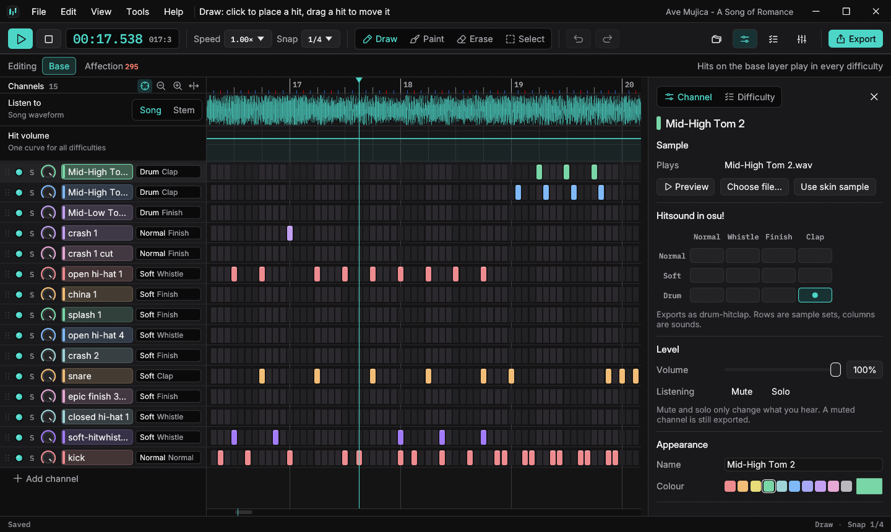
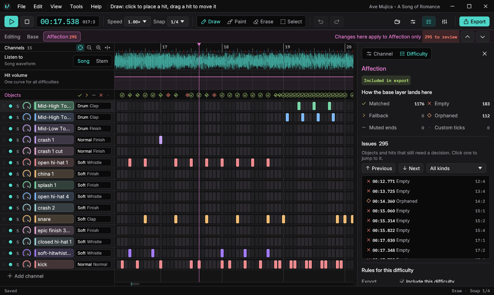
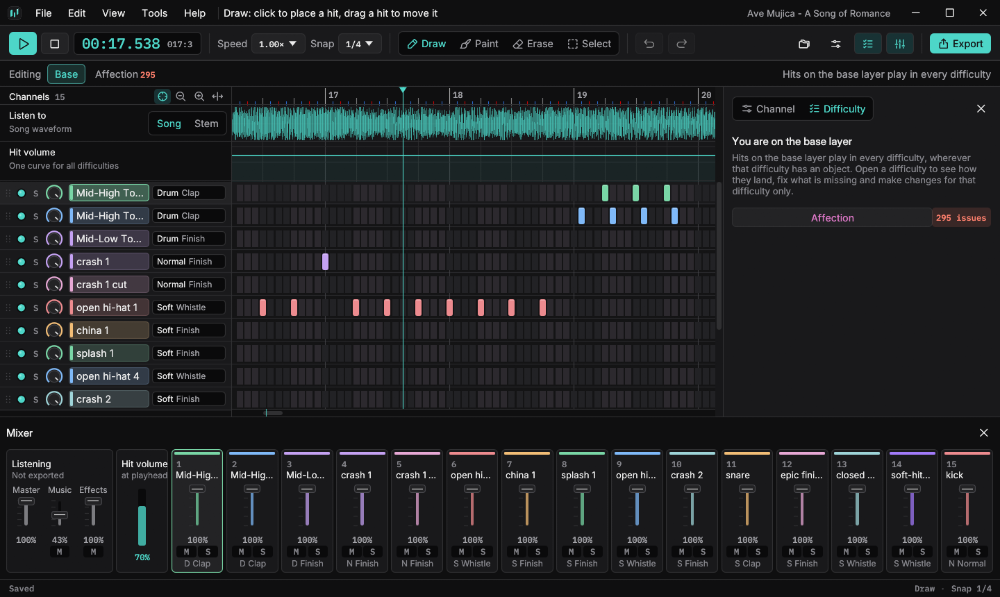
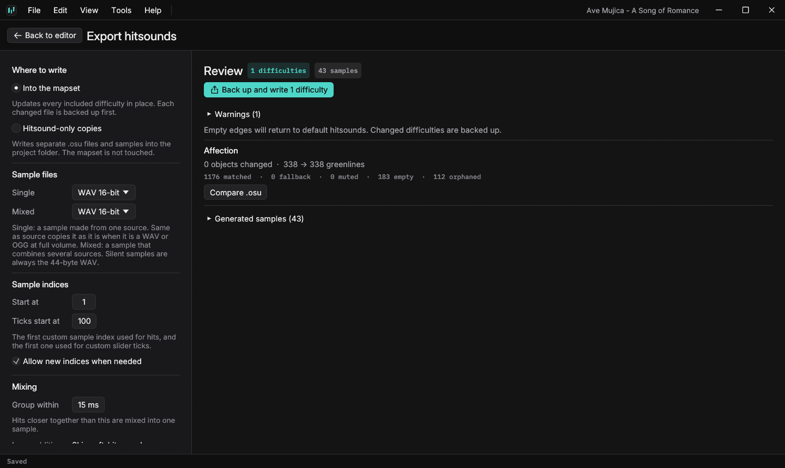

# hitsounds-rs

A DAW-style hitsounding studio for **osu!stable** (standard and catch), for Windows.

Build a song's hitsounds once, on as many channels as you like, while you listen to
the song or its drum stem. hitsounds-rs then fits them to every difficulty, makes the
merged samples, custom indices and greenlines the way
[Mapping Tools](https://github.com/OliBomby/Mapping_Tools) does, and writes them into
your `.osu` files, with backups.



> **Beta.** hitsounds-rs works end to end on real mapsets, but it is still being
> tested. Keep backups of mapsets you care about (direct export makes them for you),
> and [report anything odd](../../issues/new/choose).

## Quick start

Follow along with the [hitsounds-rs video tutorial](https://youtu.be/Sqws6Muv4F4) on YouTube.

1. **Download** the latest build from [Releases](../../releases):
   - `hitsounds-rs-<version>-setup.exe` installs for your user (no admin), or
   - `hitsounds-rs-<version>-portable.zip`: unzip it to any folder you can write to.

   Beta builds aren't code signed yet, so Windows SmartScreen asks once. Choose
   **More info** > **Run anyway**.
2. **Get set up** on the home screen. Pick a skin folder for the default hitsounds;
   your osu! Songs folder is usually found for you.
3. **New project from mapset**: choose a mapset from your Songs folder.
4. **Place hits.** Add channels, give each one a sample or skin sound, and click the
   grid. **Space** plays, **T** switches between the song and the drum stem.
5. **Check each difficulty.** Open its tab to see how the hits land on its objects and
   fix what's missing. Those fixes apply to that difficulty only.
6. **Export** (**Ctrl+E**). Review the changes, then write them into the mapset.

The [wiki](../../wiki) has the full [setup guide](../../wiki/Setting-Up), a
[first-project walkthrough](../../wiki/First-Project) and the [FAQ](../../wiki/FAQ).

## What it does

| | |
|---|---|
| **One score, every difficulty** | Hits live on a base layer. Each difficulty gets the hits that land on its objects, plus its own overrides and a fallback sound for the objects with none. |
| **Unlimited channels** | Each channel is a sample in an osu! slot (for example `drum-hitclap`), with its own volume, mute and solo. Channel order sets priority. |
| **Song or drum stem** | Switch the waveform and playback between the song and its drum stem. hitsounds-rs can separate the stem itself ([optional](../../wiki/Drum-Separation)) or use one you import. |
| **Preview that matches the game** | Playback resolves every hit the way osu!stable will: sample sets, additions, custom indices and greenline volume. |
| **Mapping Tools-style export** | Merged samples, custom indices and greenlines are generated for you. The result is read back and checked before anything is written. |
| **Safe writes** | Direct export backs up every changed `.osu` file first. Hitsound-only export leaves the mapset alone. |

| Difficulty review | Mixer | Export |
|---|---|---|
|  |  |  |

## Updates

hitsounds-rs checks GitHub Releases when it starts, downloads a newer version in the
background, and installs it when you close the app. Nothing else is sent. You can turn
this off in **App settings** > **Updates**.

## Help and feedback

- Questions: start with the [FAQ](../../wiki/FAQ).
- Bugs: [open a bug report](../../issues/new?template=bug_report.yml). If the app
  crashed, attach `crash.log` ([where to find it](../../wiki/Reporting-Bugs)).
- Ideas: [request a feature](../../issues/new?template=feature_request.yml).

## Building from source

Windows 10 or 11 and Rust 1.88 or newer:

```sh
powershell -ExecutionPolicy Bypass -File tools/fetch-onnxruntime.ps1   # once, for drum separation
cargo run -p hitsounds-rs --release
```

See [Development](../../wiki/Development) for tests, the crate layout, the design
documents in [`docs/`](docs/README.md) and how releases are made.

## Licence

MIT. The hitsound algorithms are modelled on, and partly ported from,
[Mapping Tools](https://github.com/OliBomby/Mapping_Tools) (MIT). See
[THIRD_PARTY_NOTICES.md](THIRD_PARTY_NOTICES.md) for everything hitsounds-rs ships.
hitsounds-rs is a fan-made tool and isn't affiliated with osu! or ppy.
