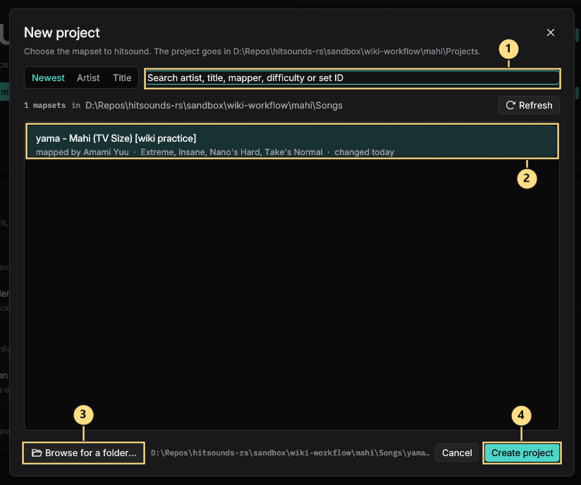
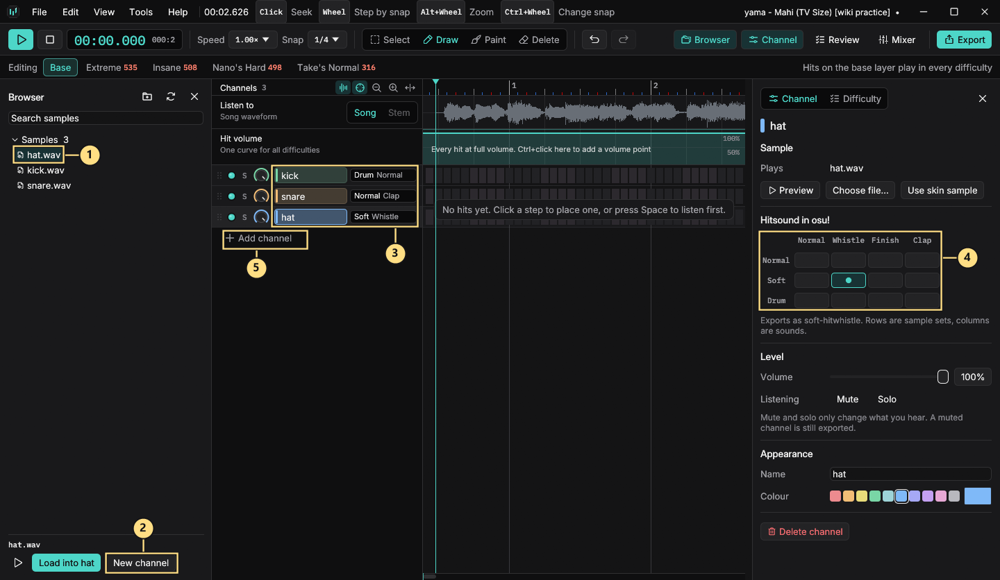
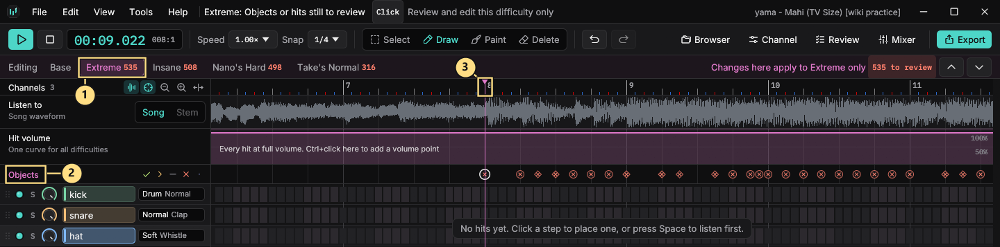
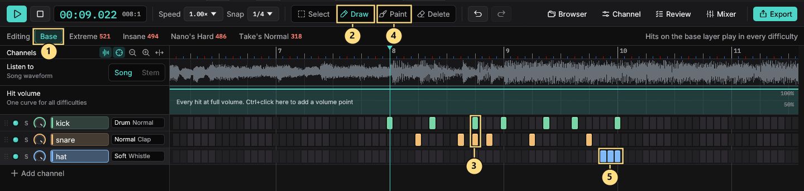
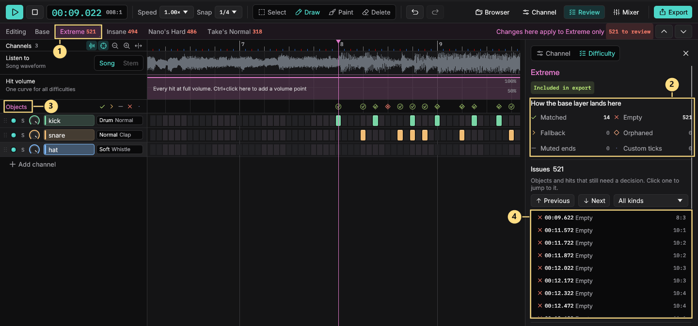
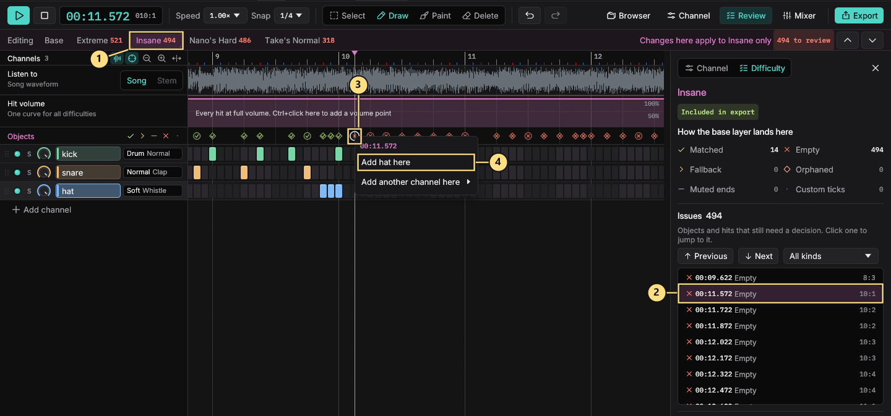
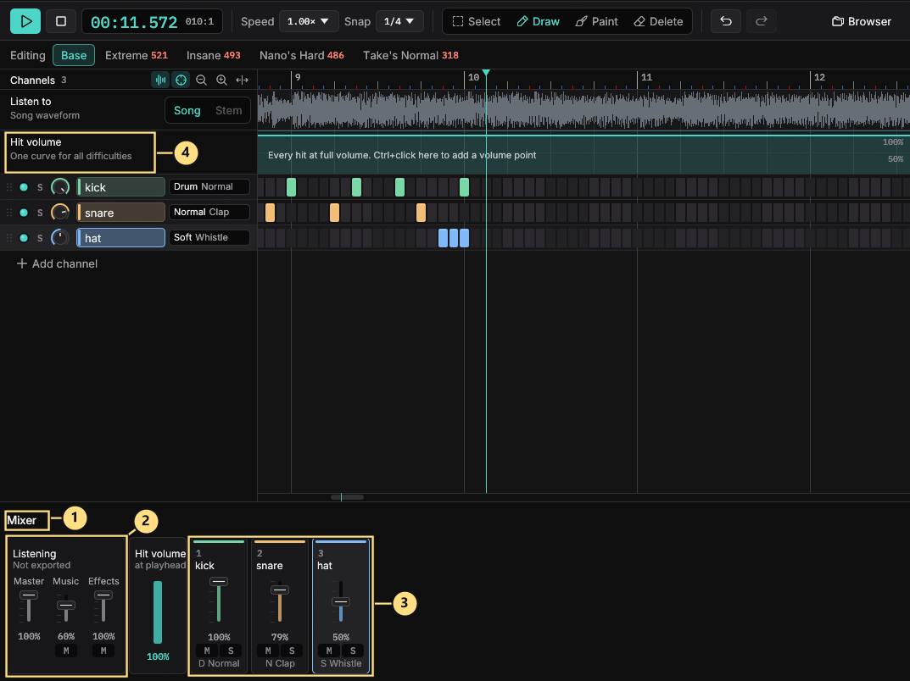
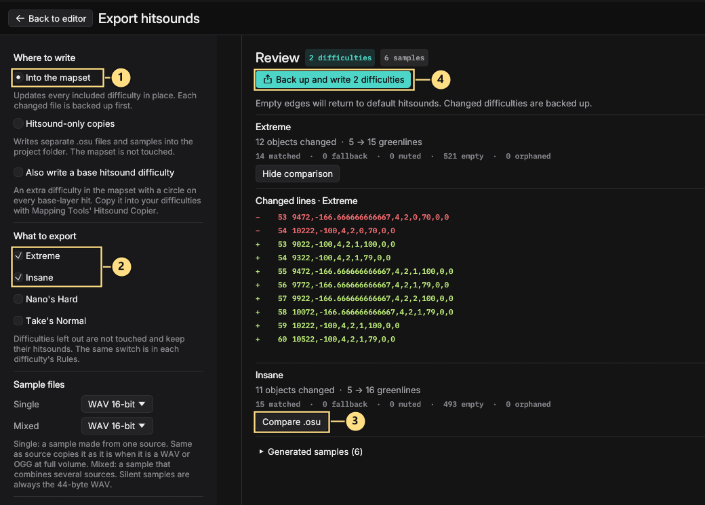

Build one hitsound arrangement on **Base**, check it on your mapset's top difficulties,
then write it into the mapset and play it in osu!stable. The screenshots use a practice
copy of **yama - Mahi (TV Size)** mapped by Amami Yuu. **Extreme** is the rhythm reference
and **Insane** is the second difficulty. The example follows the first phrase so you can
see each step clearly. Use the same process through the rest of your song.

This guide uses the default shortcuts in hitsounds-rs 0.1.0-beta.1. **F1** opens the
app's shortcut and gesture list. [Release notes](https://github.com/SEApodEErman/hitsounds-rs/releases/tag/v0.1.0-beta.1)

## 1. Create the project

1. Follow [[Setting Up|Setting-Up]] to configure your osu!stable **Songs** folder and
   skin samples. Add the folder with your own hitsound samples under **App settings**
   (**Ctrl+,**) > **Sample folders** so they appear in the Browser.
2. For a first run, copy the whole mapset folder, including the song and any assets it
   needs. Give the copy a distinct folder name. In the example, the copy also has
   **[wiki practice]** in the song title, which makes it easy to find in osu!stable.
3. Choose **New project from mapset** (**Ctrl+N**). Use the **search field (1)** to find
   the **mapset row (2)** by title, artist, mapper, difficulty or set ID. Use **Browse
   for a folder… (3)** to pick a practice folder outside the configured Songs folder.
4. Select the mapset and click **Create project (4)**. Choose where to save the
   `.hsproj` folder if the app asks. Keep it separate from the mapset folder.

The `.hsproj` holds your channels, placed hits and difficulty edits. The mapset folder
holds the song and playable `.osu` files. You can check which mapset the project points
to in **File** > **Project settings**. Use **File** > **Open recent** when you come back.

## 2. Add your channels

1. Stay on **Base**. Open the **Browser** (**F8**) and select a **sample (1)** to hear
   it. At the bottom of the Browser, click **New channel (2)** to create a row that
   plays that sample. Repeat for `kick.wav`, `snare.wav` and `hat.wav` in this example.
2. Select a **channel row (3)** and open **Channel** (**F6**). The **Hitsound in osu!
   grid (4)** assigns the sample set (row) and sound (column). The app shows the
   resulting slot below the grid. Use these assignments for the example.

   | Channel | Row | Column | Purpose |
   | --- | --- | --- | --- |
   | kick | Drum | Normal | Low accents and downbeats |
   | snare | Normal | Clap | Backbeats and sharper accents |
   | hat | Soft | Whistle | A lighter sound for the quick notes |

3. To change the sample on an existing channel, select the row and double-click a
   file in the Browser, or drag the file onto the row. **Choose file…** in **Channel**
   also works. Use **Add channel (5)** below the rack when starting with a skin sample.
   Double-click a channel name in the rack to rename it.

Give sounds that need to play together different columns in the slot grid. When
channels compete for the same sound, the higher row has priority. Use the handle at
the left of a row to reorder it.

## 3. Use the top difficulty to build Base

### Find the rhythm

1. Click **Extreme (1)**, or your own top difficulty. The **Objects lane (2)** appears
   above the channel rows. It shows the moments that can trigger a hitsound on that
   chart. Click a mark in the lane to seek to it. In a blank project, press **N** from
   the start to jump to the first Empty object. Here it is at **00:09.022 (3)**.
2. Press **Space** to listen and pause. Choose a slower **Speed** if the phrase is
   quick. Use the waveform and the closest drum attack to pick the accents you want
   to reinforce. After adding a drum stem, switch between **Song** and **Stem** with
   **T**. See [[Drum Separation|Drum-Separation]].
3. Click **Base** and keep the playhead at the same phrase. Use **Alt+wheel** over the
   phrase to zoom until you can see the step pads. Click the ruler to seek. Use the
   wheel over the timeline to step by snap when paused. The **Snap** dropdown or
   **Ctrl+wheel** changes the divisor. The example uses **1/4**.

### Place and listen

1. Check that **Base (1)** is highlighted and set **Snap** to 1/4. Pick **Draw (2)** or
   press **2**. Click a step on the kick row for each low accent, then add the snare
   on its own row. You can stack both on a step, as at **00:09.922 (3)**.
2. Pick **Paint (4)** or press **3** and drag across the hat row from **00:11.272**
   to **00:11.422 (5)**. At 1/4 snap this puts a hat on each of the three quick notes.
   Listen to the phrase from just before the first kick.

   | Channel | Example hits |
   | --- | --- |
   | kick | `00:09.022`, `00:09.472`, `00:09.922`, `00:10.222`, `00:10.672`, `00:10.972`, `00:11.422` |
   | snare | `00:09.322`, `00:09.772`, `00:09.922`, `00:10.072`, `00:10.522`, `00:11.122` |
   | hat | `00:11.272`, `00:11.347`, `00:11.422` |

Use **Select** (**1**) to box-select a phrase and drag selected hits in time or to
another channel. In **Draw**, you can drag a hit to move it and right-click it to
delete it. Use **Delete** (**4**) to remove several hits in a stroke. **Ctrl+Z** undoes
an edit. **Ctrl+C**, **Ctrl+X** and **Ctrl+V** copy, cut and paste selected hits. Paste
starts at the snapped playhead and replaces the hits in that span on the copied
channels. Use it when the same pattern returns, then listen through the join.

Work through the song one section at a time. Use the top difficulty again if you lose
where a rhythm is mapped. **Ctrl+S** saves your work to the project.

## 4. Check each difficulty

### Listen to Extreme first

1. Select **Extreme (1)** and open **Review** (**F7**). Listen to the same phrase on
   this tab to hear the sounds as projected onto Extreme's objects.
2. Read **How the base layer lands here (2)** and scan the **Objects lane (3)**. Click
   an entry in **Issues (4)** to jump to that time. Use **N** and **Shift+N** for the
   next and previous issues. The counts cover the whole difficulty, including sections
   you have yet to hitsound.
3. If the same musical accent needs fixing across difficulties, go back to **Base**.
   Keep the difficulty tab open for an edit that belongs to this chart.

| Review status | What you hear or what to check |
| --- | --- |
| Matched | One or more placed sounds land at an object or slider edge. |
| Empty | The object plays its default hitnormal. Leave it if that fits, add a hit, or set a fallback. Direct export can clear old additions from these moments. |
| Fallback | A configured channel fills an object where no placed hit landed. Set it under **File** > **Project settings** > **Fallback channel**, or for one difficulty under **Rules for this difficulty** > **Empty objects**. |
| Orphaned | A placed hit has nowhere to play on this chart. Check the Objects lane before moving it. It may already land correctly on another difficulty. |
| Muted ends / Custom ticks | These reflect the difficulty's slider rules. Check slider heads, repeats and tails as you listen. |

### Make one edit on Insane

1. Select **Insane (1)** and replay the phrase. Compare the object marks and the sounds
   that carry over.
2. In **Issues (2)** click **00:11.572 Empty**. This moves the playhead to the circle
   in the Objects lane. Select the **hat** channel and right-click that **object (3)**.
3. Choose **Add hat here (4)**. The Empty entry disappears and the object becomes
   Matched. The menu places the hit at the object's exact time, which also works for
   an edge that falls between snap points. Switch back to Extreme to confirm that its
   object at this time is still marked Empty.

If a hit sits just beside an object, check its timestamp and the difficulty's **Match
within** setting. Start with the default **5.0 ms**. Correct the snap or use the object
menu for one exact edit. Increase the window carefully and listen to the closest notes
to make sure a hit has landed where you intended. Save the project after the review.

## 5. Balance the levels

1. Open **Mixer (1)** (**F9**). Set the **Listening faders (2)** so you can hear the song
   and the added hitsounds clearly. **Master**, **Music**, **Effects**, **Mute** and
   **Solo** are for preview. Click a listening percentage to type a value.
2. Use the **channel faders (3)** to set the exported balance. Start with the kick as
   the strongest layer and lower the hat so the three fast notes stay light. Audition
   both difficulties with the song on, especially where two sounds land together.
3. For a section that needs an overall level change, use the **Hit volume lane (4)**.
   **Ctrl+click** to add a point, drag to move it, double-click to type its value and
   right-click to delete it. Click a point once to switch the segment after it between
   a ramp and a step. Edit the curve on **Base** to share it across difficulties. Editing
   it on a difficulty creates a curve for that tab. Use **Use shared** to go back to the
   Base curve.

osu! uses one greenline volume at a hit. hitsounds-rs scales the loudest channel at
that moment by the Hit volume curve and packs the other layers at their relative
levels. Check the result with the same song section in osu!stable after export.

## 6. Export into the mapset

1. Verify the mapset folder in **File** > **Project settings**. Save and close that
   mapset in the osu! editor before writing so it reloads the new files on the next
   open. If you changed objects or timing in osu!, let hitsounds-rs refresh and check
   the affected section again first.
2. Save the project and open **Export** (**Ctrl+E**). Under **Where to write (1)**
   choose **Into the mapset**. Under **What to export (2)** tick **Extreme** and
   **Insane** only for this pass. The preview rebuilds when you change the selection.
3. Read the counts for each selected difficulty. Expand any **Warnings** and review
   **Generated samples**. Use **Compare .osu (3)** to inspect the changes to hits and
   timing points before writing. An **Export blocked** message needs attention before
   the write button is available.
4. Click **Back up and write 2 difficulties (4)**. Wait for **Export complete** and
   check the reported **Output folder** and **Backup folder**. The backup of replaced
   files is under `<project>.hsproj\backups\`. Keep it until you finish checking the map.

**Hitsound-only copies** puts separate `.osu` files and their samples under
`<project>.hsproj\exports\hitsound-only\`. Use it to inspect an export outside the
mapset. **Also write a base hitsound difficulty** writes a separate circle-based
**Hitsounds (base layer)** difficulty to the chosen destination for Mapping Tools'
Hitsound Copier. Leave that box clear for the two-difficulty export above.

## 7. Verify in osu!stable

1. Open the exported mapset in osu!stable. If you worked outside the game's Songs
   folder, copy the whole **Output folder** into Songs with a distinct name. If the
   copy is missing from song select or the old files are still loaded, press **F5**
   there to refresh the beatmap list.
2. Select **Extreme** and enter the osu! editor. Find the section you worked on. Use
   **Test** (**F5** inside the editor) to play it. You can use the test mode's Autoplay
   control to hear every hit while you check the timing and balance. **Ctrl+Enter**
   at song select starts the selected difficulty with Auto from the beginning. In
   the example, listen for the combined kick and snare at `00:09.922` and the three
   quick hats at `00:11.272`–`00:11.422`.
3. Repeat on **Insane**. Listen past the shared phrase for the extra hat at `00:11.572`.
   On your own mapset, check every exported difficulty and listen through transitions
   and sliders before sharing it.
4. If something needs changing, close the osu! editor, fix it in the `.hsproj`, then
   save, export and test again. Open the reported backup folder if you need the
   pre-export `.osu` files. Your full mapset copy is the simplest way to roll back the
   audio files and difficulties together.

For the game controls, see the [osu! editor menu](https://osu.ppy.sh/wiki/en/Client/Beatmap_editor/Menu),
[test mode](https://osu.ppy.sh/wiki/en/Client/Beatmap_editor/Test_mode) and [song select shortcuts](https://osu.ppy.sh/wiki/en/Client/Keyboard_shortcuts#song-select).

## If something sounds wrong

- **A sample is missing or silent in the editor.** Preview it in the Browser and check
  **Plays** in **Channel**. For a skin sound, confirm the matching slot file exists in
  the selected skin folder. If you edited a source sample outside the app, load the
  updated file into the channel again.
- **A hit sounds on Base and disappears on a difficulty.** Look for **Orphaned** in
  Review and confirm the chart has an object or slider edge at that time. Check the
  output of that difficulty separately before changing the shared arrangement.
- **A clap or whistle also plays a normal sound.** osu! adds a hitnormal under those
  sounds. The default is the difficulty's hitnormal when no channel supplies one.
- **The exported map sounds like the old version.** Confirm the Output folder and
  difficulty and reload the map in osu!stable. In osu!'s options, turn off **Ignore
  beatmap hitsounds** and **Use skin's sound samples** if either is on. [osu! options](https://osu.ppy.sh/wiki/en/Client/Options)
- **You are working with an already hitsounded map.** Use a copy or open **Hitsound-only
  copies** first. Read the warning about Empty edges and the `.osu` comparison before
  writing any original difficulty. If you have a separate mania hitsound difficulty,
  **File** > **New project from mania hitsound diff…** can import its hits as channels.
