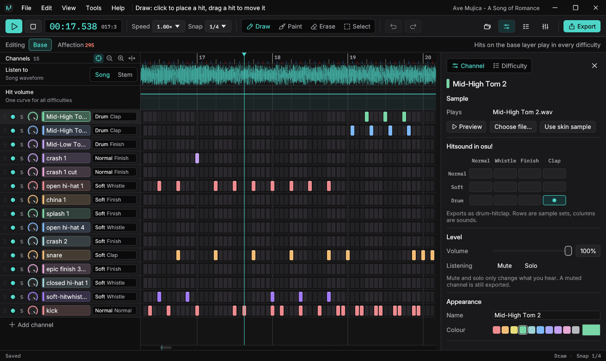
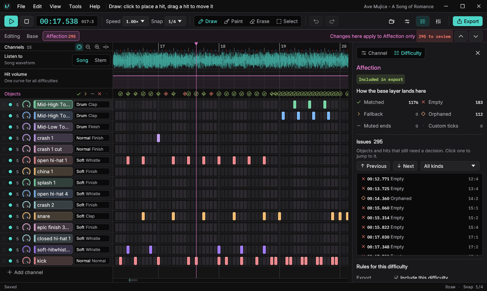
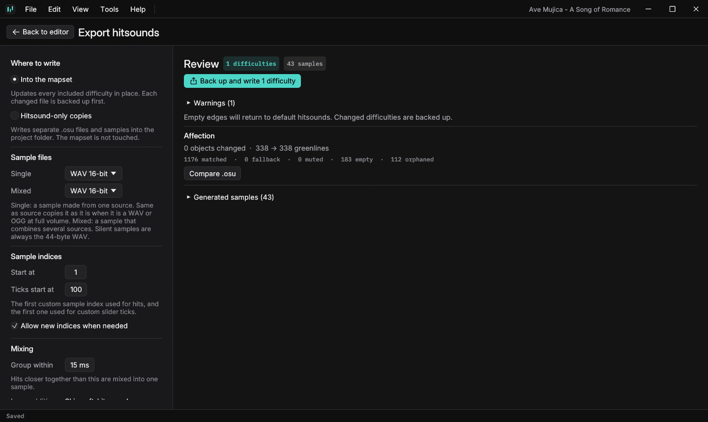

This page takes a mapset from an empty project to exported hitsounds. Press **F1** in
the app at any time for every gesture and shortcut.

## 1. Create the project

Choose **New project from mapset** (**Ctrl+N**) and pick the mapset. The list is your
Songs folder: type to search by artist, title, mapper, difficulty name or tags. Mapsets
without a standard or catch difficulty are listed but can't be chosen.

The project is a separate `.hsproj` folder, never inside the mapset. Recent projects
are on the home screen and under **File** > **Open recent**.

Already hitsounded a mania hitsound diff? **New project from mania hitsound diff**
imports its hitsounds as channels.

## 2. Hear the drums (optional)

In **Project settings**, the **Drum stem** section can:

- **Separate from song**: hitsounds-rs makes the stem itself
  (see [[Drum Separation|Drum-Separation]]), or
- **Import file…**: use a stem you made elsewhere. It must line up with the song.

Press **T** to switch between the song and the stem.

## 3. Add channels and place hits

- **Add channel** is under the channel rack. Each channel is one sound in one osu! slot,
  for example a kick sample as `drum-hitnormal`.
- **Channel settings** (**F6**) sets the sample (a file or the skin sound), the slot,
  volume and colour. Double-click a channel name to rename it.
- Channel order is priority: when two channels need the same slot at the same moment,
  the higher one wins. Drag channels to reorder them.

Tools:

| Tool | Key | What it does |
|---|---|---|
| Draw | **P** | Click a step to place a hit; drag a hit to move it in time or to another channel; drag on empty space to select. Right-click deletes. |
| Paint | **B** | Drag to fill every step of one channel. |
| Erase | **D** | Drag across hits to delete them. |
| Select | **E** | Box-select and move, without placing. |

Navigation works as in the osu! editor: the mouse wheel seeks by the snap, **Alt+wheel**
zooms, **Ctrl+wheel** changes the snap divisor. **Space** plays and pauses,
**Ctrl+Z** undoes, **Ctrl+S** saves.

The **Hit volume** lane under the waveform is a volume curve for every hit: click to add
a point, drag to move it, right-click to delete, **Ctrl+click** a segment to switch
between a ramp and a step.

## 4. Check each difficulty

The tabs next to **Base** are the difficulties. Hits on the base layer play in every
difficulty, wherever it has an object. Open a difficulty to see how they land:

| Term | Meaning |
|---|---|
| **Matched** | An object with a hit on it. |
| **Fallback** | An object with no hit, which plays the fallback channel instead. |
| **Empty** | An object with no hit and no fallback. It plays the default hitnormal. |
| **Orphaned** | A hit with no object under it in this difficulty, so it doesn't play here. |

**Difficulty review** (**F7**) lists the issues; **N** and **Shift+N** step through them.
Edits made while a difficulty tab is open apply to that difficulty only. The review
panel also sets the difficulty's fallback, how far a hit may sit from an object, and
slider settings.

## 5. Mix

The **Mixer** (**F9**) has a strip per channel and the listening levels. **Master**,
**Music** and **Effects** only change what you hear; they never change the export.
Channel volume does: at each hit, the loudest channel playing, scaled by the
**Hit volume** curve, sets the greenline volume.

## 6. Export

Open **Export** (**Ctrl+E**). The review builds by itself and shows, for each
difficulty, what changes and which samples are generated. **Compare .osu** shows the
exact line changes.

- **Into the mapset** writes every included difficulty in place. Each changed file is
  backed up first, to `<project>.hsproj\backups\`.
- **Hitsound-only copies** writes separate `.osu` files and samples into the project's
  `exports\hitsound-only\` folder and leaves the mapset alone.

Before writing, hitsounds-rs reads the result back and checks that every hit plays what
you placed. If a check fails, the export is blocked and nothing is written.

Then open the map in osu! and listen.

## While you work

hitsounds-rs watches the mapset. If you change timing or objects in the osu! editor, the
project refreshes by itself, so you can map and hitsound side by side.
