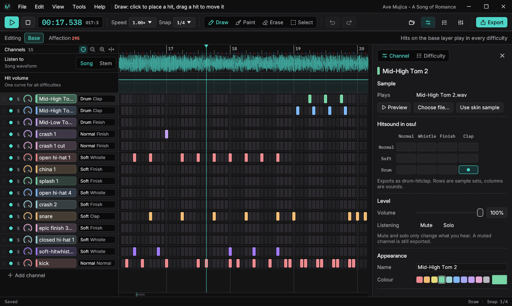

Welcome to the hitsounds-rs wiki.

hitsounds-rs is a DAW-style hitsounding studio for osu!stable (standard and catch) on
Windows. You build a song's hitsounds once, on as many channels as you need, and
hitsounds-rs fits them to every difficulty and writes them into the mapset.

## Using hitsounds-rs

- [[Setting Up|Setting-Up]]: install, first run, skin samples, Songs folder, updates.
- [[First Project|First-Project]]: from an empty project to an exported mapset.
- [[Drum Separation|Drum-Separation]]: make the optional drums model and separate a stem.
- [[FAQ]]: common questions and problems.

## Getting help

- [[Reporting Bugs|Reporting-Bugs]]: what to include, and where `crash.log` is.
- [Open an issue](https://github.com/SEApodEErman/hitsounds-rs/issues/new/choose) for
  bugs and feature requests.

## Contributing

- [[Development]]: build from source, run the tests, find your way around the code,
  and make a release.

> These pages live in the main repository under `wiki/`. Edit them there in a pull
> request; `tools/publish-wiki.ps1` copies them here.
