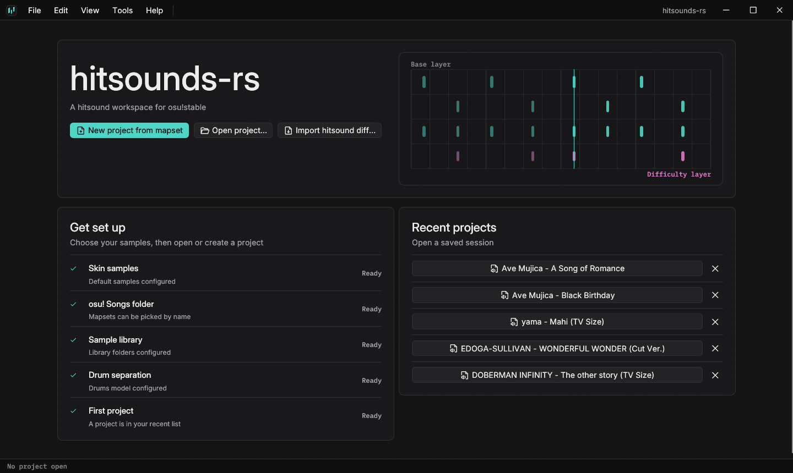

## Requirements

- Windows 10 or 11, 64-bit.
- osu!stable with at least one mapset in its Songs folder.
- A skin folder with osu!'s default hitsound files (see [Skin samples](#skin-samples)).

## Install

Download the latest build from
[Releases](https://github.com/SEApodEErman/hitsounds-rs/releases). There are two kinds:

| File | What it does |
|---|---|
| `hitsounds-rs-<version>-setup.exe` | Installs to `%LOCALAPPDATA%\Programs\hitsounds-rs` for your Windows user, with a Start menu shortcut. It needs no administrator rights. Uninstall it from **Settings** > **Apps**. |
| `hitsounds-rs-<version>-portable.zip` | Unzip it to any folder you can write to and run `hitsounds-rs.exe`. Keep the files together: `onnxruntime.dll` is needed for drum separation. |

Both kinds keep their settings in the same place, so you can switch between them.

### "Windows protected your PC"

Alpha builds aren't code signed yet, so Microsoft Defender SmartScreen doesn't know
them. The first time you run the setup or the exe, choose **More info** >
**Run anyway**. Updates that hitsounds-rs downloads itself don't ask again.

## First run

The home screen has a **Get set up** list. Each step shows **Ready** when it's done.

### Skin samples

hitsounds-rs plays and exports the osu! default hitsounds (`normal-hitnormal.wav`,
`soft-hitclap.wav` and so on) from a skin folder you choose. It doesn't ship them,
because the osu! default samples aren't freely redistributable.

Choose a skin folder that has the default hitsound files. The skin you play with
usually does. Change it later in **App settings** (**Ctrl+,**).

### osu! Songs folder

New projects are created by picking a mapset from your Songs folder. hitsounds-rs finds
the folder of a standard osu!stable install by itself, including a moved Songs
folder. If yours wasn't found, choose it in **App settings**.

### Sample library (optional)

Add the folders where you keep your hitsound samples. The **Browser** (**F8**) lists
them: click a sample to hear it, double-click it or drag it onto a channel to use it.

### Drum separation (optional)

hitsounds-rs can separate the song's drums into a stem, so you can hear what you are
hitsounding. It needs a model file you make once; see [[Drum Separation|Drum-Separation]].
Everything else works without it, and you can always import a stem you separated
elsewhere.

### Projects folder (optional)

Set a projects folder in **App settings**, and new projects are created there without
asking. Without one, hitsounds-rs asks where to save each project.

## Updates

hitsounds-rs checks GitHub Releases about five seconds after it starts. When a newer
version is out, it downloads it in the background and shows a message:

- **Restart now** saves (it asks first), installs the update and opens hitsounds-rs again.
- **Later** installs it the next time you close hitsounds-rs.

The download is checked against its SHA-256 before anything is installed. The check
sends nothing except the request itself. Turn it off, or check by hand, in
**App settings** > **Updates**.

Alpha builds move to newer alpha builds and then to the first stable release. A stable
build never gets alpha builds.

## Where hitsounds-rs keeps things

| What | Where |
|---|---|
| App settings, the Songs list cache, `crash.log`, downloaded updates | `%APPDATA%\dev.hitsounds-rs.app\` |
| A project | The `.hsproj` folder you saved it in: `project.json`, samples, stems |
| Backups made by direct export | `<project>.hsproj\backups\<time>\` |
| Hitsound-only exports | `<project>.hsproj\exports\hitsound-only\` |

Uninstalling leaves your settings and projects in place.
